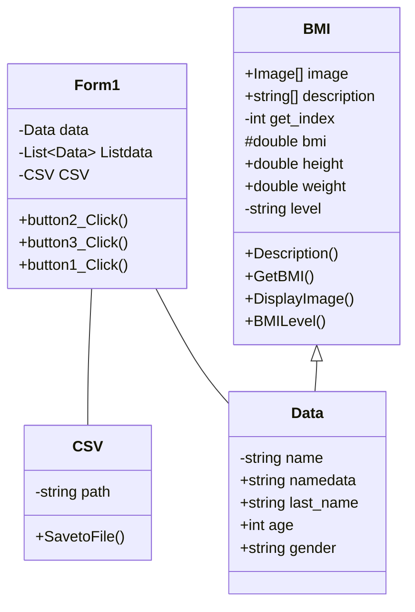

# โปรแกรมคำนวณค่า BMI (Final Project วิชา OOP)

โปรแกรม Windows Forms เขียนด้วย C# สำหรับคำนวณค่าดัชนีมวลกาย (BMI) บอกเกณฑ์น้ำหนักพร้อมคำแนะนำด้านสุขภาพ และบันทึกผลลงไฟล์ CSV

## ความเป็นมา

ปัจจุบันมีคนเสี่ยงเป็นโรคขาดสารอาหารและโรคอ้วนมากขึ้น ผมจึงทำโปรแกรมนี้ขึ้นเพื่อให้ผู้ใช้ทราบค่า BMI ของตนเอง เข้าใจสุขภาพของตนเองมากขึ้น และรู้ว่าควรปรับการออกกำลังกายและการบริโภคอาหารอย่างไร

## วัตถุประสงค์ของโปรแกรม

ทำให้ทราบว่าค่าดัชนีมวลกาย (BMI) ของเราอยู่ระดับไหน สุขภาพเป็นอย่างไร และนำไปใช้ป้องกันหรือแก้ไขปัญหาการเกิดโรคต่าง ๆ ได้

## ความสามารถ

- กรอกชื่อ นามสกุล เพศ อายุ น้ำหนัก (กิโลกรัม) และส่วนสูง (เซนติเมตร) แล้วกด **คำนวณ**
- แสดงค่า BMI เกณฑ์น้ำหนัก รูปภาพประกอบ และคำแนะนำตามเกณฑ์
- เก็บผลของทุกคนที่คำนวณไว้ในตารางด้านล่างของหน้าจอ
- กด **บันทึก** เพื่อเขียนข้อมูลในตารางลงไฟล์ `dataBMI.csv`
- กด **ล้างข้อมูล** เพื่อเคลียร์ช่องกรอกและผลลัพธ์

## เกณฑ์ที่ใช้

สูตร: `BMI = น้ำหนัก (กก.) ÷ ส่วนสูง (ม.)²`

| ค่า BMI | เกณฑ์ |
|---|---|
| น้อยกว่า 18.5 | น้ำหนักต่ำกว่าเกณฑ์ |
| 18.5 – 22.9 | น้ำหนักสมส่วน |
| 23.0 – 24.9 | น้ำหนักเกินมาตรฐาน |
| 25.0 – 29.9 | น้ำหนักอยู่ในเกณฑ์อ้วน |
| 30.0 ขึ้นไป | น้ำหนักอยู่ในเกณฑ์อ้วนมาก |

## วิธีรันโปรแกรม

ต้องใช้ Windows และ [.NET 8 SDK](https://dotnet.microsoft.com/download/dotnet/8.0)

**ใช้ Visual Studio 2022**

1. เปิดไฟล์ `Final Project.sln`
2. กด `F5` เพื่อรัน

**ใช้ command line**

```
dotnet run --project "Final Project.csproj"
```

ไฟล์ `dataBMI.csv` จะถูกสร้างในโฟลเดอร์เดียวกับตัวโปรแกรมที่ build แล้ว (เช่น `bin\Debug\net8.0-windows\`)

## โครงสร้างโปรแกรม

| ไฟล์ | หน้าที่ |
|---|---|
| `Form1.cs` | หน้าจอหลักและการทำงานของปุ่มคำนวณ ล้างข้อมูล และบันทึก |
| `BMI.cs` | คลาสแม่ คำนวณค่า BMI หาเกณฑ์ รูปภาพ และคำแนะนำ |
| `Data.cs` | คลาสลูกของ `BMI` เก็บข้อมูลส่วนตัวของผู้ใช้ |
| `CSV.cs` | เขียนข้อมูลลงไฟล์ CSV |
| `Resources/` | รูปภาพประกอบของแต่ละเกณฑ์ |

แนวคิด OOP ที่ใช้: Encapsulation (กำหนดสิทธิ์เข้าถึงข้อมูลและใช้ getter/setter) และ Inheritance (`Data` สืบทอดจาก `BMI`)



## ผู้พัฒนาโปรแกรม

นายปภพ สุระทิพย์
